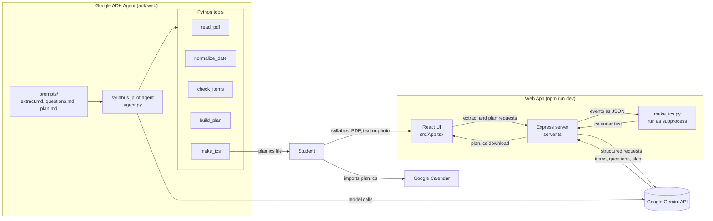

# 📅 SyllabusPilot


### Turn any messy course syllabus into a study plan in your calendar.

[](https://www.python.org/)
[](https://nodejs.org/)
[](https://react.dev/)
[](LICENSE)

<br>

<table>
  <tr>
    <th width="50%">Before: a messy syllabus</th>
    <th width="50%">After: a ready study calendar</th>
  </tr>
  <tr>
    <td></td>
    <td></td>
  </tr>
</table>

**[Problem](#-the-problem) · [Solution](#-the-solution) · [How It Works](#-how-it-works) · [Quickstart](#-quickstart) · [Demo](#-demo) · [Team](#-team-smile-and-wave)**

</div>

---

## 📌 The Problem

At the start of every semester, students receive five to eight syllabi. One is a 12-page PDF with the midterm on page 9. One is a photo of a lecture slide that says "Essay due week 11", with no date attached. One is a table pasted into an email, with the columns broken.

Most students never turn these into a plan. They hear about the midterm a week before it happens, or they miss the essay because it was mentioned on page 9. Students who do plan spend an evening copying dates into a calendar, then repeat the work whenever a date moves.


---

## 💡 The Solution

SyllabusPilot is an AI agent. You give it a syllabus in any shape: a PDF, pasted text, or a photo. It:

1. **Finds every graded item**: exams, assignments, quizzes, labs, and papers, with their due dates and grade weights.
2. **Shows what it found** in a table, so you can check the results.
3. **Asks at most three short questions**, such as how many hours a week you can study.
4. **Builds a week-by-week study plan**, with more preparation before major exams and papers.
5. **Saves the plan as an `.ics` calendar file**, which imports into Google Calendar, Apple Calendar, or Outlook.


---

## 🧭 How It Works

SyllabusPilot has two parts that do the same job in different ways.

### Agent (Python, Google ADK)

`syllabus_pilot/agent.py` defines a Google Agent Development Kit agent that uses Gemini. Its instructions are split into three files, so each one can be edited separately:

- `prompts/extract.md` covers how to find graded items and build the table.
- `prompts/questions.md` sets the three-question limit.
- `prompts/plan.md` covers how to spread study sessions across the weeks.

The agent calls five tools:

- **`read_pdf`** extracts text from PDFs with pypdf.
- **`normalize_date`** turns dates such as "Oct 3rd" or "Week 7" into ISO dates.
- **`check_items`** confirms that grade weights add up to 100% and flags missing dates and duplicate items.
- **`build_plan`** spreads preparation sessions across the weeks before each due date, giving exams and papers the most time.
- **`make_ics`** writes an RFC 5545 calendar file.

### Web App (TypeScript, React, Express)

`server.ts` calls Gemini with a JSON schema, so the extracted items and the plan come back in a fixed format. The React interface lets you edit the table, answer the questions, view the plan in a calendar or a weekly view, and download `plan.ics`. The server runs `make_ics.py` to generate the calendar file.



---

## 🛠️ Tech Stack

- **Agent:** Python 3.10+, Google Agent Development Kit (ADK), Gemini, pypdf, ics
- **Web app:** React 19, TypeScript, Vite, Tailwind CSS, Recharts, Express, `@google/genai`

---

## 🚀 Quickstart

### Prerequisites

- Node.js v20 or newer
- Python 3.10 or newer
- A free Gemini API key from [Google AI Studio](https://aistudio.google.com/apikey)

### 1. Clone the repository

```bash
git clone https://github.com/mintyross/SyllabusPilot.git
cd SyllabusPilot
```

### 2. Run the web app

```bash
npm install --legacy-peer-deps
```

Create a `.env` file in the root directory:

```env
GEMINI_API_KEY=your_gemini_api_key_here
PORT=3000
```

Start the app:

```bash
npm run dev
```

Open [http://localhost:3000](http://localhost:3000).

### 3. Run the agent with the ADK CLI (optional)

```bash
pip install -r requirements.txt
cd syllabus_pilot
adk web
```

Open [http://localhost:8000](http://localhost:8000) and select `syllabus_pilot`.

---

## 🎬 Demo

1. Upload the messiest syllabus you can find.
2. Answer one question, such as "How many hours a week can you study?"
3. Review the study plan.
4. Import `plan.ics` into Google Calendar.


### Importing `plan.ics` into Google Calendar

1. Open [Google Calendar](https://calendar.google.com).
2. Click the gear icon in the top right, then **Settings**.
3. In the left menu, select **Import & export**.
4. Click **Select file from your computer** and choose `plan.ics`.
5. Click **Import**. Your study blocks and deadlines will appear.

---

## 🔮 Future Work

- Plan several courses at once, spreading busy weeks across them.
- Reschedule the plan when life changes, for example "I was sick for three days."
- Send a short reminder message for each study day.
- Sync directly with Google Calendar through its API, instead of importing a file.
- Support more date formats and more languages.
- Save syllabi and plans so students can return to them later.

---

## 🏆 Hackathon

SyllabusPilot was built at **Coding with AI: Building Agents**, a hackathon run by GDG on Campus Riga Technical University (Google Developer Group Riga) on 2 November 2026 at RTU, Riga.

- **Challenge:** 01 (Beginner): SyllabusPilot
- **Track:** AI Agents / Student Productivity

---

## 👥 Team: Smile and Wave

- **Sofija Korņejeva**, robotics engineer and software developer, team captain ([profile](https://hack.gdgriga.com/u/13))
- **Marija Jupite**, IT student ([profile](https://hack.gdgriga.com/u/15))
- **Cenk Pala** ([profile](https://hack.gdgriga.com/u/42))
- **Ilma K** ([profile](https://hack.gdgriga.com/u/63))
- **Rostyslav Hrabenko** ([LinkedIn](https://www.linkedin.com/in/rostyslav-hrabenko-450829437/))


---

## 📄 License

Released under the MIT License. See [LICENSE](LICENSE).
